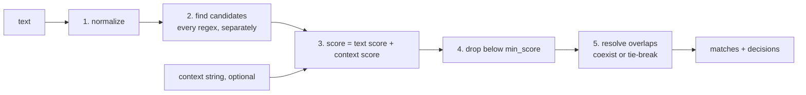

# CARP: Context-Aware Regex Parser

```text
         ,-/|/|/|\-.
  |\   ,'/|/|/|/|/|`-.
  | `-'  ((((((((((   `.
  |  _   ))))))))))  o  \
 <  / `. ((((((((((    _.'~
  | `-.'`-.._____..-'
  |/   `-.
```

CARP finds regex matches in text and scores each one by the words around it,
plus the words of an optional context string. When two matches overlap, it
keeps the better one. Every rule lives in `extraction_config.yaml`.

**The full rules are in [docs/REFERENCE.md](docs/REFERENCE.md).** This page
is the overview.

## How it works



In words:

1. **Normalize** the text: whitespace, dashes, quotes.
2. **Find candidates.** Every regex runs on the text, each on its own, so
   overlaps stay visible.
3. **Score** each candidate: add the weights of its pattern's words found near
   it in the text, plus those found anywhere in the context. Closer words count
   more; the context's last word counts as the closest.
4. **Drop** candidates below `min_score`.
5. **Resolve overlaps.** If the two labels are listed in `coexist`, keep both.
   Otherwise apply `overlap_tiebreak` in order: score, length, priority.

### Keywords

Every keyword is a `word: weight` pair (negative weights lower the score).
Where it is looked for depends on the key:

| Key | Looked for in |
| --- | --- |
| `keywords` | the text around the match **and** the context |
| `nearby` | the text around the match only |
| `context` | the context only |

You normally write just `keywords`:

```yaml
- label: phone_number
  priority: 2
  regex: '\d{3}-\d{3}-\d{4}'
  keywords: {phone: 3, call: 2, acct: -3}
```

See [Scoring](docs/REFERENCE.md#scoring) and [Keywords](docs/REFERENCE.md#keywords).

### Example: an overlap

`2125550123` matches both `phone_number` and `account_number`:

```text
text:     "acct 2125550123"
                ^^^^^^^^^^
candidates: account_number  score 3.0   ("acct" is next to it, weight 3)
            phone_number    score 0.0   (no phone words nearby)
result:     account_number wins, decided_by = score
```

The context can tip the same overlap. With the text `"2125550123 call"`,
phone wins on its own; add the context `"account"` and account_number wins.

### Phone numbers

A pattern can hand its matches to the
[phonenumbers](https://github.com/daviddrysdale/python-phonenumbers) library
with a `validate:` block. CARP doesn't guess the country: each plausible
reading of a number comes back as its own match.

```yaml
- label: phone_number
  priority: 2
  regex: '\+?\(?\d[\d\s().-]{6,18}\d'   # broad: catches anything phone-shaped
  keywords: {phone: 3, call: 2}
  validate:
    with: phonenumbers
    regions: [US]                        # parsed in order; the first is home
    hints: {GB: {uk: 3}, IN: {india: 3}} # optional: words that point to a region
```

- **Labels** are `{status}_{REGION}_number`. A **valid** number in a known
  range becomes `valid_US_number`, and `extra.normalized` holds its E.164
  form (`+12125550123`). The right length in an unknown range (a new area
  code, say) becomes `possible_US_number`. Nothing is lost.
- **Impossible hits** (wrong length everywhere) are dropped and logged in the
  report.
- **Where a number is parsed**, in order:
  1. A leading `+`: the country code decides.
  2. The regions whose hint words appear: only those regions are parsed. If the number fits none of them, CARP
     falls back to the list.
  3. Every region in `regions`. `readings` chooses what comes back; by
     default, every valid reading plus the home region's possible one.
- **Several valid readings.** When a number is valid in several hinted
  regions, all of them are returned. Set `hint_conflict: nearest` to keep
  only the one whose hint word is nearest.
- `coexist` and the summaries use the pattern label (`phone_number`), so a
  rule written for it covers every reading.

```text
text:    "our UK office called India at 98765 43210"
match:   valid_IN_number  extra.normalized +919876543210  (fits IN, not GB)
```

Without `hints`, the same text gives `possible_US_number`, since 10 digits
fit the US length. Add `hints` or `regions` for the countries in your data;
every listed region also adds readings, though, junk included.

Results can change when you upgrade phonenumbers, because its data changes;
every report row records the version. See
[Phone numbers](docs/REFERENCE.md#phone-numbers).

## Setup

Python 3.10+.

```bash
python -m venv .venv
.venv/bin/python -m pip install -r requirements.txt   # PyYAML, pytest, phonenumbers
```

## Quick start

CLI (one text per run; prints JSON):

```bash
.venv/bin/python extract.py --config extraction_config.yaml \
    --text 'Invoice INV-004521 dated 03/14/2026, amount due $1,250.00'
```

Phone matches also carry an `extra` object (normalized number, region,
status, ...).

```json
[
  {"label": "invoice_number", "text": "INV-004521", "start": 8, "end": 18, "score": 4.0},
  {"label": "date", "text": "03/14/2026", "start": 25, "end": 35, "score": 3.0},
  {"label": "amount", "text": "$1,250.00", "start": 48, "end": 57, "score": 3.0}
]
```

Library:

```python
from extract import load_config, extract

cfg = load_config("extraction_config.yaml")

matches, decisions = extract("some text", cfg)
```

Looping over many inputs, writing the report as you go:

```python
from extract import load_config, extract, open_report, reset_report

cfg = load_config("extraction_config.yaml")
reset_report()
items = [("id-1", "call", "Call 212-555-0123"), ("id-2", "", "Invoice INV-004521")]

with open_report() as write:           # opens the file once, holds nothing in memory
    for id, context, text in items:
        matches, decisions = extract((context, text), cfg, source=id)
        write(decisions)
        # use `matches` here
```

To see why a match won, add `--report`. That writes every decision to
`extract_report.csv`, with each score split into its text and context parts.
Then run `extract.py --summarize` for a table of the overlaps worth tuning,
of the labels the context pointed to that produced no match (likely
misses), and of the phone checks (statuses, regions, numbers with several readings,
and possible numbers sharing an area code, a sign that phonenumbers' data is stale). See [CLI](docs/REFERENCE.md#cli),
[Library](docs/REFERENCE.md#library) and
[Summaries](docs/REFERENCE.md#summaries).

## Tests

```bash
.venv/bin/python -m pytest -q -p no:cacheprovider
```

## Files

| File | Role |
| --- | --- |
| `extract.py` | the extractor and CLI |
| `summarize.py` | `summarize_overlaps()` / `summarize_misses()` / `summarize_validation()` and their `format_*()` tables: the summaries of a report CSV (re-exported by `extract.py`) |
| `phone.py` | phone validation for `validate:` patterns (phonenumbers; imported only when used) |
| `words.py` | `prev_words()` / `next_words()` word lookups around a match |
| `extraction_config.yaml` | settings, patterns, coexist pairs, test cases |
| `test_extract.py` | pytest suite |
| `docs/REFERENCE.md` | the full rules: CLI flags, scoring, keywords, tie-breaks, output files, migration |
| `CLAUDE.md` | project instructions for Claude Code |
