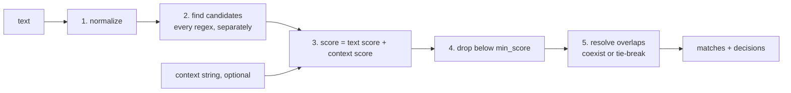

# CARP: Context-Aware Regex Parser

```text
         ,-/|/|/|\-.
  |\   ,'/|/|/|/|/|`-.
  | `-'  ((((((((((   `.
  |  _   ))))))))))  o  \
 <  / `. ((((((((((    _.'~
  | `-.'`-.._____..-'
  |/   `-.
```

CARP finds things in text with regular expressions, then decides which finds
to trust by reading the words around them. Everything it knows lives in one
YAML file, and every decision it makes can be written to a report.

**The full rules and the decision flow are in
[docs/REFERENCE.md](docs/REFERENCE.md).** This page is the overview.

## Why CARP

A regex can tell you that `2125550123` is ten digits. It can't tell you
whether those digits are a phone number or an account number, or whether
`2026-03-14 10:00` is a date or a timestamp. The answer is in the words
nearby: `acct` points one way, `call` the other.

CARP adds that missing step:

- **Find broadly, decide by context.** Write simple regexes, even ones that
  overlap on purpose, and list the words that make each one right or wrong.
- **Use outside context when you have it.** A column name, a form field or an
  email subject can be passed as a `context` string. Its words count too.
- **Tune it in YAML, not code.** No model, no training. Change a weight, run
  again, see the result.
- **See why.** Every drop, win and tie-break is logged with the rule that
  decided it, and a summary shows where to tune first.
- **Don't lose things quietly.** Phone numbers can be checked with Google's
  phone metadata, and a number in a range the library doesn't know yet is kept
  as `possible`, not thrown away. Labels the context pointed to that produced
  nothing are flagged as likely misses.

Good fit: extracting IDs, dates, amounts and phone numbers from invoices,
emails, tickets and logs, where several patterns can match the same digits.
Not a fit: free-form language understanding. CARP only scores words you list.

## How to use it

1. **Describe what to find.** One entry per thing: a label, a priority (lower
   wins ties), and a regex.
2. **Add the words that make it right.** List words that raise the score
   (`call: 2`) and words that lower it (`acct: -3`).
3. **Run it.** From the command line for one text, or from Python for many.
4. **Check why, then tune.** Add `--report`, run `--summarize`, and adjust the
   weights the summary points at.

```yaml
patterns:
  - label: phone_number
    priority: 2
    regex: '\d{3}-\d{3}-\d{4}'
    keywords: {phone: 3, call: 2, acct: -3}
  - label: account_number
    priority: 3
    regex: '\b\d{10}\b'
    keywords: {account: 3, acct: 3, call: -2}
```

The shipped `extraction_config.yaml` has these two patterns and several more.
Run it on a text:

```bash
.venv/bin/python extract.py --config extraction_config.yaml \
    --text 'Invoice INV-004521 dated 03/14/2026, amount due $1,250.00'
```

```json
[
  {"label": "invoice_number", "text": "INV-004521", "start": 8, "end": 18, "score": 4.0},
  {"label": "date", "text": "03/14/2026", "start": 25, "end": 35, "score": 3.0},
  {"label": "amount", "text": "$1,250.00", "start": 48, "end": 57, "score": 3.0}
]
```

## How it decides



1. **Normalize** the text: whitespace, dashes, quotes.
2. **Find candidates.** Every regex runs on the text on its own, so
   overlaps stay visible.
3. **Score** each candidate: add the weights of its pattern's words found near
   it in the text, plus those found anywhere in the context. Closer words count
   more; the context's last word counts as the closest.
4. **Drop** candidates below `min_score`.
5. **Resolve overlaps.** If the two labels are listed in `coexist`, keep both.
   Otherwise apply `overlap_tiebreak` in order: score, length, priority.

Phone patterns add a check between steps 3 and 4. The
[decision flow](docs/REFERENCE.md#decision-flow) in the reference shows every
branch as a diagram.

### Keywords

Every keyword is a `word: weight` pair (negative weights lower the score).
Where it is looked for depends on the key:

| Key | Looked for in |
| --- | --- |
| `keywords` | the text around the match **and** the context |
| `nearby` | the text around the match only |
| `context` | the context only |

You normally write just `keywords`. See [Scoring](docs/REFERENCE.md#scoring)
and [Keywords](docs/REFERENCE.md#keywords).

### Example: an overlap

`2125550123` matches both `phone_number` and `account_number`:

```text
text:     "acct 2125550123"
                ^^^^^^^^^^
candidates: account_number  score 3.0   ("acct" is next to it, weight 3)
            phone_number    score 0.0   (no phone words nearby)
result:     account_number wins, decided_by = score
```

The context can tip the same overlap. With the text `"2125550123 call"`,
phone wins on its own; add the context `"account"` and account_number wins.

## Phone numbers

A pattern can hand its matches to the
[phonenumbers](https://github.com/daviddrysdale/python-phonenumbers) library
with a `validate:` block. CARP doesn't guess the country: each plausible
reading of a number comes back as its own match.

```yaml
- label: phone_number
  priority: 2
  regex: '\+?\(?\d[\d\s().-]{6,18}\d'   # broad: catches anything phone-shaped
  keywords: {phone: 3, call: 2}
  validate:
    with: phonenumbers
    regions: [US]                        # parsed in order; the first is home
    hints: {GB: {uk: 3}, IN: {india: 3}} # optional: words that point to a region
```

- **Labels** are `{status}_{REGION}_number`. A **valid** number in a known
  range becomes `valid_US_number`, and its `text` is the number in E.164
  form (`+12125550123`). Set `output_format` to `INTERNATIONAL`, `NATIONAL` or
  `RAW` (the text as written) to change that. The right length in an unknown range (a new area
  code, say) becomes `possible_US_number`. Nothing is lost.
- **Impossible hits** (wrong length everywhere) are dropped and logged in the
  report.
- **Where a number is parsed**, in order:
  1. A leading `+`: the country code decides.
  2. The regions whose hint words appear. `hint_fallback` decides whether
     the list is also parsed: by default only when no hinted reading is
     valid (`not_valid`); or `impossible`, `always`, `never`.
  3. Every region in `regions`. `readings` chooses what comes back; by
     default, every valid reading plus the home region's possible one.
- **Several valid readings.** When a number is valid in several hinted
  regions, all of them are returned. Set `hint_conflict: nearest` to keep
  only the one whose hint word is nearest.
- `coexist` and the summaries use the pattern label (`phone_number`), so a
  rule written for it covers every reading.

```text
text:    "our UK office called India at 98765 43210"
match:   valid_IN_number  text +919876543210  (fits IN, not GB)
```

Without `hints`, the same text gives `possible_US_number`, since 10 digits
fit the US length. Add `hints` or `regions` for the countries in your data;
every listed region also adds readings, though, junk included.

Results can change when you upgrade phonenumbers, because its data changes;
every report row records the version. See
[Phone numbers](docs/REFERENCE.md#phone-numbers) and the
[phone decision flow](docs/REFERENCE.md#phone-decision-flow).

## Setup

Python 3.10+.

```bash
python -m venv .venv
.venv/bin/python -m pip install -r requirements.txt   # PyYAML, pytest, phonenumbers
```

## Quick start

CLI: see step 3 above. It scans one text per run and prints JSON. Phone
matches have the same fields; their `text` is the normalized number, and
`start`/`end` still point at the number as written.

Library:

```python
from extract import load_config, extract

cfg = load_config("extraction_config.yaml")

matches, decisions = extract("some text", cfg)
```

Looping over many inputs, writing the report as you go:

```python
from extract import load_config, extract, open_report, reset_report

cfg = load_config("extraction_config.yaml")
reset_report()
items = [("id-1", "call", "Call 212-555-0123"), ("id-2", "", "Invoice INV-004521")]

with open_report() as write:           # opens the file once, holds nothing in memory
    for id, context, text in items:
        matches, decisions = extract((context, text), cfg, source=id)
        write(decisions)
        # use `matches` here
```

## Seeing why

Add `--report` to the CLI, or write `decisions` from the library. That
produces `extract_report.csv` with one row per decision and each score split
into its text and context parts. Then run:

```bash
.venv/bin/python extract.py --summarize
```

It prints up to three tables:

- **Overlaps worth tuning:** pairs of labels that fight over the same text
  without the score deciding.
- **Likely misses:** labels the context pointed to that produced no match.
- **Phone checks:** statuses, regions, numbers with several readings, and
  possible numbers sharing an area code (a sign that phonenumbers' data is
  stale).

See [CLI](docs/REFERENCE.md#cli), [Library](docs/REFERENCE.md#library),
[Reading the report](docs/REFERENCE.md#reading-the-report) and
[Summaries](docs/REFERENCE.md#summaries).

## Tests

```bash
.venv/bin/python -m pytest -q -p no:cacheprovider
```

## Files

| File | Role |
| --- | --- |
| `extract.py` | the extractor and CLI |
| `summarize.py` | `summarize_overlaps()` / `summarize_misses()` / `summarize_validation()` and their `format_*()` tables: the summaries of a report CSV (re-exported by `extract.py`) |
| `phone.py` | phone validation for `validate:` patterns (phonenumbers; imported only when used) |
| `words.py` | `prev_words()` / `next_words()` word lookups around a match |
| `extraction_config.yaml` | settings, patterns, coexist pairs, test cases |
| `test_extract.py` | pytest suite |
| `docs/REFERENCE.md` | the full rules: CLI flags, decision flow, scoring, keywords, tie-breaks, output files, migration |
| `releasenotes.md` | breaking changes per release, written so a downstream system (or Claude) can adjust its calling code |
| `CLAUDE.md` | project instructions for Claude Code |
