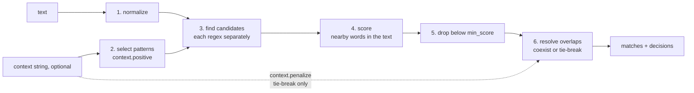

# CARP: Context-Aware Regex Parser

```text
         ,-/|/|/|\-.
  |\   ,'/|/|/|/|/|`-.
  | `-'  ((((((((((   `.
  |  _   ))))))))))  o  \
 <  / `. ((((((((((    _.'~
  | `-.'`-.._____..-'
  |/   `-.
```

CARP finds regex matches in text and scores each one by the words around it.
When two matches overlap, it keeps the better one. Every rule lives in
`extraction_config.yaml`.

**The full rules are in [docs/REFERENCE.md](docs/REFERENCE.md).** This page
is the overview.

## How it works



In words:

1. **Normalize** the text: whitespace, dashes, quotes.
2. **Select patterns.** If you pass a context string, only the patterns whose
   `context.positive` words appear in it run. With no context, or no hits, all
   patterns run.
3. **Find candidates.** Each regex runs on its own, so overlaps stay visible.
4. **Score** each candidate: add the weights of `nearby` words found near it
   in the text. Closer words count more.
5. **Drop** candidates below `min_score`.
6. **Resolve overlaps.** If the two labels are listed in `coexist`, keep both.
   Otherwise apply `overlap_tiebreak` in order: score, context penalty, length,
   priority.

### Which input each keyword reads

This is the part that trips people up:

| Keyword kind | Reads | Does |
| --- | --- | --- |
| `context.positive` | the context string | selects which patterns run |
| `context.penalize` | the context string | breaks ties only, never changes the score |
| `nearby` | the text around the match | sets the score |

You normally write a single `keywords` map and let CARP fill in all three:

```yaml
- label: phone_number
  priority: 2
  regex: '\d{3}-\d{3}-\d{4}'
  keywords: {phone: 3, call: 2, acct: -3}
```

A positive word becomes `context.positive` and `nearby`. A negative word
becomes `nearby` and `context.penalize`.
See [Keywords](docs/REFERENCE.md#keywords-keywords-the-usual-way).

### Example: an overlap

`5551234567` matches both `phone_number` and `account_number`:

```text
text:     "acct 5551234567"
                ^^^^^^^^^^
candidates: account_number  score 3.0   ("acct" is a nearby word, weight 3)
            phone_number    score 0.0   (no phone words nearby)
result:     account_number wins, decided_by = score
```

## Setup

Python 3.10+.

```bash
python -m venv .venv
.venv/bin/pip install -r requirements.txt   # PyYAML, pytest
```

## Quick start

CLI (one text per run; prints JSON):

```bash
.venv/bin/python extract.py --config extraction_config.yaml \
    --text 'Invoice INV-004521 dated 03/14/2026, amount due $1,250.00'
```

```json
[
  {"label": "invoice_number", "text": "INV-004521", "start": 8, "end": 18, "score": 4.0},
  {"label": "date", "text": "03/14/2026", "start": 25, "end": 35, "score": 3.0},
  {"label": "amount", "text": "$1,250.00", "start": 48, "end": 57, "score": 3.0}
]
```

Library:

```python
from extract import load_config, extract

cfg = load_config("extraction_config.yaml")

matches, decisions = extract("some text", cfg)
```

Looping over many inputs, writing the report as you go:

```python
from extract import load_config, extract, open_report, reset_report, reset_error_log, log_context_miss

cfg = load_config("extraction_config.yaml")
reset_report()
reset_error_log()                      # only if you use log_context_miss
items = [("id-1", "call", "Call 555-123-4567"), ("id-2", "", "Invoice INV-004521")]

with open_report() as write:           # opens the file once, holds nothing in memory
    for id, context, text in items:
        matches, decisions = extract((context, text), cfg, source=id)
        write(decisions)
        for d in decisions:            # optional: deep troubleshooting
            if d["kind"] == "context_miss":
                log_context_miss(id, context, text, d)
        # use `matches` here
```

To see why a match won, add `--report`. That writes every decision to
`extract_report.csv`. Then run `extract.py --summarize` for a table of the
overlaps worth tuning. See [CLI](docs/REFERENCE.md#cli),
[Library](docs/REFERENCE.md#library) and
[Overlap summary](docs/REFERENCE.md#overlap-summary).

## Tests

```bash
.venv/bin/python -m pytest -q -p no:cacheprovider
```

## Files

| File | Role |
| --- | --- |
| `extract.py` | the extractor and CLI |
| `summarize.py` | `summarize_overlaps()` / `format_summary()`: the overlap summary of a report CSV (re-exported by `extract.py`) |
| `words.py` | `prev_words()` / `next_words()` word lookups around a match |
| `extraction_config.yaml` | settings, patterns, coexist pairs, test cases |
| `test_extract.py` | pytest suite |
| `docs/REFERENCE.md` | the full rules: CLI flags, keywords, tie-breaks, output files, migration |
| `CLAUDE.md` | project instructions for Claude Code |
