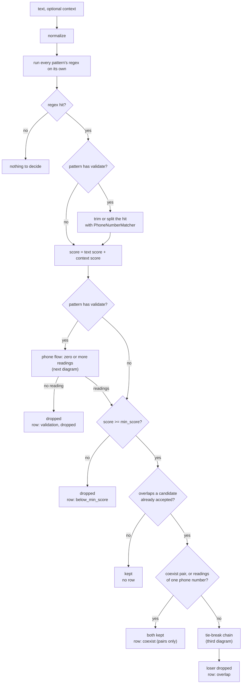
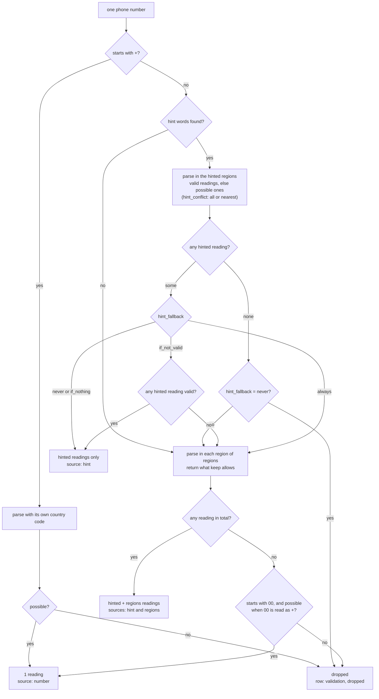
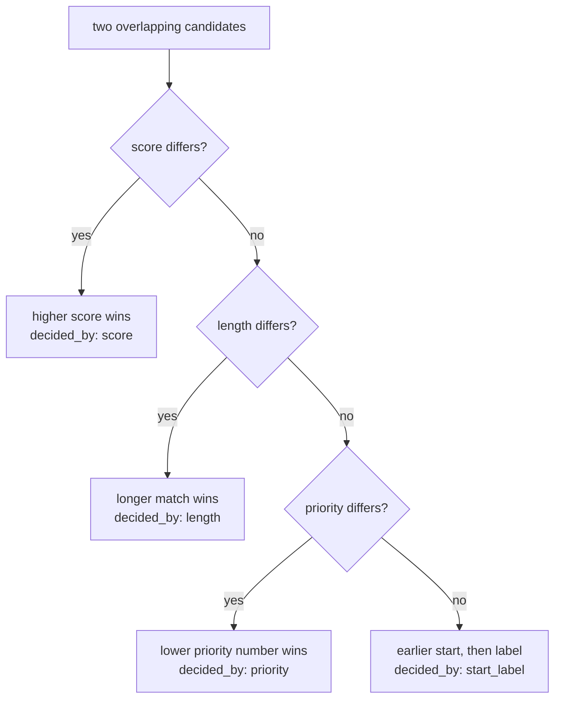

# CARP reference

The full rules. For an overview, see the [README](../README.md).

## Usage

### CLI

Scans one text per run. For many texts, or a CSV of them, use the library.

```bash
.venv/bin/python extract.py --config extraction_config.yaml \
    [--text TEXT] [--context TEXT] [--report]
.venv/bin/python extract.py --summarize [PATH]
```

- `--text TEXT` is the text to scan. If omitted, the text is read from stdin
  (UTF-8, `errors="replace"`).
- `--context TEXT` is an optional context string. Its words add to the score
  of every pattern that lists them (see [Scoring](#scoring)).
- Prints the matches as a JSON list of `{label, text, start, end, score}`.
  For a pattern with `validate`, `text` is the number in `output_format`
  (E.164 by default), not the input slice (see [Phone numbers](#phone-numbers)).
- Writes nothing else unless asked: `--report` writes the decision log to
  `./extract_report.csv` (overwritten each time).
- `--summarize [PATH]` prints the [overlap and miss summaries](#summaries) of
  a report (default `./extract_report.csv`) and exits. It needs no `--config`
  and cannot be combined with `--text`, `--context` or `--report`.
- Config warnings go to stderr as `warning: ...` and do not change the exit code.
- Exit codes: `0` success; `2` for a config or report error (`error: ...` on
  stderr, nothing printed) or a usage error.

Example:

```bash
.venv/bin/python extract.py --config extraction_config.yaml --report \
    --text 'Invoice INV-004521 dated 03/14/2026, amount due $1,250.00'
echo 'call 212-555-0123' | .venv/bin/python extract.py --config extraction_config.yaml --context phone
.venv/bin/python extract.py --summarize
```

### Library

```python
from extract import load_config, extract

cfg = load_config("extraction_config.yaml")

matches, decisions = extract("some text", cfg)
matches, _ = extract({"text": "some text", "context": "call"}, cfg)   # ignore the log
matches, decisions = extract(("call", "some text"), cfg, source="id-1")  # (context, text)
```

`extract()` returns `(matches, decisions)` and **writes no files**.
`matches` are the candidates that survived scoring and overlap resolution; each
has `label`, `text`, `start`, `end`, `score`, and the breakdown `text_score`
and `context_score` (`score` is their sum). Offsets refer to the
**normalized** text. For a pattern with `validate`, `text` is the formatted
number (see [Phone numbers](#phone-numbers)); `text[start:end]` of the input
gives the written form. `decisions` is the flat decision log (see
[Output files](#output-files)); ignore it, keep it, or write it with the helpers
below. `source` fills its `file` column.

Looping over many inputs, writing the report as you go:

```python
from extract import load_config, extract, open_report, reset_report

cfg = load_config("extraction_config.yaml")
reset_report()
items = [("id-1", "call", "Call 212-555-0123"), ("id-2", "", "Invoice INV-004521")]

with open_report() as write:           # opens the file once, holds nothing in memory
    for id, context, text in items:
        matches, decisions = extract((context, text), cfg, source=id)
        write(decisions)
        # use `matches` here
```

Then summarize the report:

```python
from extract import (summarize_overlaps, format_summary, summarize_misses, format_misses,
                     summarize_validation, format_validation)

print(format_summary(summarize_overlaps()))       # the overlap table --summarize prints
print(format_misses(summarize_misses()))          # the miss table printed under it
print(format_validation(summarize_validation()))  # phone validation, printed last
```

## Decision flow

What happens to every piece of text, and which report row each decision
leaves. Read the steps top to bottom; each flow also has a diagram you can
expand.

### From text to matches

Each candidate goes through these steps in order. The tag after an arrow is the
report row the step writes.

1. **Normalize.** Text and context: whitespace, dashes, quotes (only the
   options you enabled).
2. **Run every pattern's regex on its own.**
   - **no hit** → nothing to decide for that pattern.
3. **Is it a phone pattern (has `validate`)?**
   - **yes** → trim or split the hit with PhoneNumberMatcher. If it finds
     nothing, the raw hit stays.
   - **no** → use the hit as it is.
4. **Score: text score + context score.** A phone reading keeps the score of
   the hit it came from.
5. **Phone pattern?**
   - **yes** → run the [phone flow](#phone-decision-flow). It returns zero or
     more readings.
     - **no reading** → the hit is dropped and logged. → `row: validation, dropped`
   - **no** → go to step 6.
6. **Score at least `min_score`?**
   - **no** → the candidate is dropped. → `row: below_min_score`
   - **yes** → continue.
7. **Overlaps a candidate already accepted?** Candidates are taken best first,
   in `overlap_tiebreak` order.
   - **no** → the candidate is kept. → *no row*
   - **yes** → go to step 8.
8. **Coexist pair, or readings of one phone number?**
   - **yes** → both are kept. Readings of one number never compete with each
     other. → `row: coexist` (pairs only)
   - **no** → run the [tie-break chain](#tie-break-chain). The loser is
     dropped. → `row: overlap`
9. **Misses, at the end.** Each label the context scored above 0 that has no
   match gets a `miss` row.

<details>
<summary>Same flow as a diagram</summary>



</details>

- **Scoring comes before the phone check**, so a phone reading keeps the score
  of the hit it came from.
- **Candidates are taken best first**, in `overlap_tiebreak` order, and each
  is compared with the ones already accepted. That is why the loser is always
  the lower-ranked one.
- **A candidate that survives with no overlap writes no row.** Rows record
  decisions; nothing was decided.
- **Misses** are explained in [Misses](#misses).

### Phone decision flow

For one phone-shaped hit in a pattern with a `validate:` block. The result is
zero or more readings, and each reading becomes a match.

1. **Does the number start with `+`?**
   - **yes, possible** → parse it with its own country code: one reading,
     source `number`. **Done.**
   - **yes, not possible** → the hit is dropped. → `row: validation, dropped`
   - **no** → go to step 2.
2. **Are there hint words for any region?**
   - **no** → go to step 5.
   - **yes** → parse in the hinted regions: valid readings, else possible
     ones. `hint_conflict` (`all` or `nearest`) picks among regions.
3. **Did any hinted region give a reading?**
   - **none** → with `hint_fallback: never` the hit is dropped; otherwise go
     to step 5.
   - **some** → go to step 4.
4. **What does `hint_fallback` say?**
   - **`never`, `if_nothing`** → keep the hinted readings only, source
     `hint`. **Done.**
   - **`if_not_valid`** → is any hinted reading valid? Yes: keep the hinted
     readings only (**done**). No: go to step 5.
   - **`always`** → go to step 5. The hinted readings stay.
5. **Parse in each region of `regions`.** Keep what `keep` allows, and add
   the readings you already have from the hints, if any.
   - **some readings** → keep them, sources `hint` and `regions`. **Done.**
   - **none** → go to step 6.
6. **Does it start with `00`?**
   - **yes, and possible when `00` is read as `+`** → one reading, source
     `number`. **Done.**
   - **otherwise** → the hit is dropped, with the reason in the report.
     → `row: validation, dropped`

<details>
<summary>Same flow as a diagram</summary>



</details>

- **Never a guess about the country.** Every reading that survives is
  kept, labeled with its status and region (`valid_US_number`,
  `possible_GB_number`).
- **Hints narrow the search first.** A hint word is a reason to look at a
  region, not a verdict. `hint_fallback` says when the `regions` list gets a
  turn too.
- **Dropped means logged.** Every dropped hit has a `validation` row with the
  reason, such as `impossible in US (TOO_SHORT)`.
- **Several readings of one number** share its span and score and never
  compete with each other. Each competes with other patterns normally.

### Tie-break chain

When two candidates overlap and are not a `coexist` pair, `overlap_tiebreak`
runs these in order. A criterion you leave out is skipped.

1. **Does the score differ?**
   - **yes** → the higher score wins. → `decided_by: score`
   - **no** → next criterion.
2. **Does the length differ?**
   - **yes** → the longer match wins. → `decided_by: length`
   - **no** → next criterion.
3. **Does the priority differ?**
   - **yes** → the lower number wins. → `decided_by: priority`
   - **no** → last resort.
4. **Still tied.** The earlier start wins, then the label.
   → `decided_by: start_label` (nothing in your input decided it; add
   keywords)

<details>
<summary>Same flow as a diagram</summary>



</details>

An empty `overlap_tiebreak` goes straight to `start_label`. A `start_label` result in the summary means nothing
in your input decided it, which is the cue to add keywords.

### Worked example

Context `Acct`, text `Acct 2125550123 call 212-555-0123`, with the example
config (decay on, `min_score` 0, `phone_number` validated for the US):

| Step | What happens |
| --- | --- |
| Find | `account_number` hits `2125550123`. `phone_number` hits `2125550123` and `212-555-0123`. |
| Score | `account_number`: text `acct` +3, `call` -2 = 1.0; context `acct` +3; total **4.0**. Phone hit 1: `call` +2 = **2.0**. Phone hit 2: `call` +2 = **2.0**. |
| Validate | Both phone hits are valid in the US: two `validation` rows, `kept`, source `regions`. Labels become `valid_US_number`. |
| `min_score` | All three are at or above 0. No `below_min_score` rows. |
| Overlap | `account_number` and the first phone reading share a span. Not a coexist pair, so the chain runs: score 4.00 > 2.00. The `overlap` row says `decided_by: score`, and the phone reading is dropped. |
| Result | `account_number` `2125550123` (4.0) and `valid_US_number` `+12125550123` (2.0, written `212-555-0123`). The second phone hit overlapped nothing, so it has no row beyond its validation row. |

The same text without the context scores `account_number` 1.0 against the
first phone reading's 2.0, so the phone reading wins instead. That flip is the
context doing its job.

### Worked example: account or phone, two regions

The example config with `regions: [US, GB]`. Context `customer phone`, text
`Acct 2125550123 on file`. The number is real in the US and only the right
shape in GB, and the context points to a phone.

| Step | What happens |
| --- | --- |
| Find | `account_number` and `phone_number` both hit `2125550123` (5-15). The phone library confirms the span, so nothing is trimmed. |
| Score | `account_number`: text `acct` +3 (1 word away); context `phone` -3 (the context's last word, distance 1); total **0.0**. Phone hit: no phone words in the text; context `phone` +3; total **3.0**. |
| Validate | No `+`, no hint words, so it is parsed in each region of `regions`. US: `+12125550123` **valid**. GB: `+442125550123` only **possible**. `keep: valid_plus_home` keeps the valid reading and the home region's possible one; the home region (US) is already valid, so GB is not kept. |
| `min_score` | 0.0 and 3.0 are both at or above 0. |
| Overlap | `valid_US_number` and `account_number` share a span and are not a coexist pair. Score 3.00 > 0.00: the phone reading wins. |
| Result | `valid_US_number`, `text` `+12125550123`, `start` 5, `end` 15, score 3.0. |

The report has three rows:

| kind | outcome | a_label | a_text | normalized | decided_by | reason |
| --- | --- | --- | --- | --- | --- | --- |
| validation | kept | valid_US_number | 2125550123 | +12125550123 | regions | valid in US |
| validation | not_kept | possible_GB_number | 2125550123 | +442125550123 | regions | possible in GB; keep: valid_plus_home |
| overlap | a_wins_b_dropped | valid_US_number (b: account_number) | 2125550123 | | score | score 3.00 > 0.00 |

The overlap row also has `b_text_score` 3.0 and `b_context_score` -3.0, which
shows the context cancelling the `Acct`.

What changes the outcome:

- **No context:** `account_number` wins 3.0 to 0.0. Both validation rows are
  still written; the phone reading is the loser in the overlap row.
- **`keep: all`:** `possible_GB_number` (`+442125550123`) and
  `valid_US_number` both come back on the span, score 3.0 each. They do not
  compete with each other, and both beat `account_number`.
- **A GB hint** (`hints: {GB: {london: 2}}`, text `Acct 2125550123 london
  office`): GB is parsed first, and the number is only possible there. With the
  default `hint_fallback: if_not_valid` the regions are parsed too, so both readings
  come back; the reason says `hint GB not valid; hint_fallback: if_not_valid
  parsed the regions too`.
- **The same hint with `hint_fallback: never`:** only `possible_GB_number`
  comes back. The US reading is never tried.
- **`acct` does not lower the phone score,** because the phone pattern lists
  `account`, not `acct`. Keywords are exact words; add `acct: -2` to the phone
  keywords to make it count.

## Reading the report

Each row of `extract_report.csv` is one decision. `kind` says which step wrote
it, `outcome` what happened, and `decided_by` the rule that decided.

| `kind` | Written when | `outcome` | `decided_by` |
| --- | --- | --- | --- |
| `validation` | a phone hit was checked: one row per reading, or one for an impossible hit | `kept`, `not_kept`, `dropped` | `number`, `hint`, `regions` |
| `below_min_score` | a candidate scored under `min_score` | `dropped` | `min_score` |
| `overlap` | two candidates overlapped and one lost | `a_wins_b_dropped` | `score`, `length`, `priority`, `start_label` |
| `coexist` | two candidates overlapped but their labels are a coexist pair | `both_kept` | `coexist` |
| `miss` | the context scored a label above 0 and it has no match | `no_candidates`, `candidates_dropped` | (empty) |

Questions the report answers:

| Question | Where to look |
| --- | --- |
| Why did `A` beat `B`? | the `overlap` row: `a_*` is the winner, `b_*` the loser; `reason` shows the numbers |
| Why is my match missing? | `b_` side of an `overlap` row; a `below_min_score` row; a `validation` row with `dropped`; or a `miss` row |
| Why `possible_US_number` and not `valid_US_number`? | the `validation` row: `status`, `region`, and `reason` |
| Why was a phone reading not kept? | a `validation` row with `not_kept`; `reason` names the `keep` or `hint_conflict` setting |
| What do I tune first? | `extract.py --summarize` (see [Summaries](#summaries)) |

## How it works

1. **Load**: read the YAML and compile each regex once (IGNORECASE unless
   `case_sensitive`). An invalid regex fails with a message naming its label.
   Bad keywords, unknown keys and unknown values fail too, each with a
   message naming the pattern and key (see [Keywords](#keywords) and
   [Config options](#config-options)).
2. **Normalize** the text (and context): collapse whitespace, unicode dashes to
   `-`, smart quotes to ASCII, each only if enabled.
3. **Find candidates**: every pattern runs on the text, each separately with
   `finditer`. Patterns are never combined into one alternation, so overlaps
   stay visible. Zero-length matches (e.g. from `\d*`) are skipped. The
   context never decides which patterns run, and regexes never run on it.
   A pattern with `validate` is scanned the same way, but each regex hit is
   first trimmed or split by phonenumbers (see [Phone numbers](#phone-numbers)).
4. **Score** each candidate: `score = text_score + context_score` (below).
   **Validate** the candidates of `validate` patterns: each becomes one match
   per reading (`valid_US_number`, ...) or is dropped as impossible, before
   they compete.
5. **Drop** candidates with `score < min_score`.
6. **Resolve overlaps**, best first, using `overlap_tiebreak` (in order; any
   of `score`, `length`, `priority`). If every listed criterion ties, or the
   list is empty, the earlier start and then the label decide. A pair of
   labels listed in `coexist` keeps both. Identical spans count as
   overlapping. Every decision records what decided it (`decided_by`).
7. **Misses**: each label the context scored above 0 that ended with no match
   gets a `miss` decision (see [Misses](#misses)).

## Scoring

A candidate's score is two independent sums, added:

| Part | Reads | Keyword keys |
| --- | --- | --- |
| `text_score` | the words around the match in the text | `keywords` + `nearby` |
| `context_score` | every word of the context string | `keywords` + `context` |

Both use the same matcher: whole words or phrases, case-insensitive, each
keyword counted once at its nearest occurrence. With `distance_decay`, a
keyword's weight is divided by its word distance (nearest word = 1).

- **Text window:** up to `context_window_words` words before and/or after the
  match (`context_direction`: `before`, `after` or `both`), stopping early at
  any `stop_at` character. Before the match a phrase's last word sets its
  distance; after it, its first word.
- **Context string:** read whole, as if it came right before the match. Its
  **last** word is distance 1, the one before it 2, and so on; a phrase's last
  word sets its distance. `context_window_words`, `context_direction` and
  `stop_at` do not apply.
- A `keywords` word found in both places counts in both: with
  `keywords: {phone: 3}`, context `phone` and text `phone 212-555-0123`, the
  score is 3 + 3 = 6.
- The context has no position relative to any one match, so it adds the same
  amount to every candidate of a pattern.
- With no context (or an empty one), `context_score` is 0 and nothing else
  changes.

Example (from `extraction_config.yaml`, decay on):

```text
context:  "Acct"
text:     "Acct 2125550123 call 212-555-0123"
account_number 2125550123:  text acct +3, call -2  -> 1;  context acct +3  -> 4.0
phone_number   2125550123:  text call +2           -> 2;  context          -> 2.0
  -> overlap, account_number wins by score
phone_number   212-555-0123: text call +2          -> 2.0, no overlap, kept
                                                      (as valid_US_number)
```

## Keywords

Each pattern has up to three maps of `word: signed weight`:

```yaml
- label: phone_number
  keywords: {phone: 3, call: 2, acct: -3}   # text window AND context string
  nearby:   {ext: 1}                        # text window only
  context:  {customer: 2, invoice: -2}      # context string only
```

- Use `keywords` for most words. Use `nearby` or `context` when a word should
  count in only one place.
- A word in `keywords` may not also be in `nearby` or `context` of the same
  pattern (load error), so there are no precedence rules. The same word in both
  `nearby` and `context` is fine.
- A negative weight lowers the score. Weight 0 is a load error.

**Keywords match whole words exactly.** There is no stemming, no
abbreviation and no partial match: `account` does not match `acct` or
`accounts`. List each spelling your data uses (`account: 3, acct: 3`).

Keywords are ASCII letters only. Apostrophes join a word (`don't` -> `dont`);
spaces, hyphens, digits and everything else separate words, so the keyword
`e-mail` means the two words `e` `mail`. The context string is split into
words the same way as the text. To avoid keywords that would silently match
the wrong words, `load_config` fails with a message naming the pattern, key
and keyword when:

- a keyword has a digit or an accented letter (`w2`, `1099`, `café`) or no letters;
- the same keyword appears twice under one key of a pattern, also when spelled
  differently (`amount due` and `amount-due` are the same words);
- a word is in `keywords` and also in `nearby` or `context`;
- a weight is 0 or not a number.

Quote YAML words that YAML would read as something else: unquoted, `on`,
`yes`, `true` load as `True`, and `off`, `no`, `false` as `False`.
`load_config` rejects such keywords ("must be a string (quote it in the
YAML ...)") instead of silently turning them into "true" or "false". Write
`"on": 1`, not `on: 1`. A blank entry (a `null` / `~` key) fails with "has an
empty entry; remove it".

Leaving out `keywords`, `nearby` or `context`, or leaving them blank, is fine:
the pattern simply has no keywords of that kind and scores 0 there.

## Config options

Everything lives in `extraction_config.yaml`, in five sections: `settings`,
`normalize`, `patterns`, `coexist` and `tests`. Every option is listed below.
"Required" means `load_config` fails without it; an unknown value fails with a
message naming the section and key.

### `settings`

| Option | Required / default | Values | What it does |
| --- | --- | --- | --- |
| `context_window_words` | required | a whole number, e.g. `8` | How many words on each side of a match are searched for keywords. |
| `context_direction` | default `both` | `before`, `after`, `both` | Which side(s) of the match the text window covers. The context string is always read whole. |
| `stop_at` | default `""` (none) | a string of characters, e.g. `".!?"` | The text window scan stops at the first of these characters, so words in the next sentence don't count. Does not apply to the context string. |
| `distance_decay` | required | `true`, `false` | `true`: a keyword's weight is divided by its distance in words (1 = next to the match; in the context, the last word is 1). `false`: full weight at any distance. |
| `min_score` | required | a number, e.g. `0` | A candidate scoring below this is dropped (`below_min_score` row). Valid phone readings are exempt by default (`valid_ignores_min_score`). |
| `case_sensitive` | required | `true`, `false` | Whether the regexes are case-sensitive. Keywords always match regardless of case. |
| `overlap_tiebreak` | required (may be empty) | a list of `score`, `length`, `priority`, in the order to try | How an overlap between two candidates is decided: higher score, then longer match, then lower priority number. Anything still tied (or an empty list) goes to the earlier start, then the label. |

### `normalize`

Each option is off unless set to `true`. Offsets (`start`, `end`) refer to the
normalized text.

| Option | What it does |
| --- | --- |
| `collapse_whitespace` | Turns every run of spaces, tabs and newlines into one space. |
| `unicode_dashes_to_hyphen` | Turns en and em dashes (`–` `—`) into `-`. |
| `smart_quotes_to_ascii` | Turns curly quotes (`‘ ’ “ ”`) into straight ones (`' "`). |

### `patterns`

A list; each entry is one thing to find.

| Option | Required / default | Values | What it does |
| --- | --- | --- | --- |
| `label` | required, unique | text, e.g. `phone_number` | The name a match is reported under. For a pattern with `validate`, matches get generated labels (`valid_US_number`) and this name is their `pattern`. |
| `priority` | required | a whole number | Breaks ties in `overlap_tiebreak`: the lower number wins. |
| `regex` | required | a regular expression (quote it in single quotes) | What to find. Each pattern's regex runs on its own, so overlaps stay visible. |
| `keywords` | optional | `{word: weight}` | Words that raise (positive weight) or lower (negative weight) the score, looked for in the text window **and** the context string. |
| `nearby` | optional | `{word: weight}` | Like `keywords`, but looked for in the text window only. |
| `context` | optional | `{word: weight}` | Like `keywords`, but looked for in the context string only. |
| `validate` | optional | a block, below | Checks matches as phone numbers. |

Keywords are whole words matched exactly (see [Keywords](#keywords)). A weight
of 0 is an error, and a word in `keywords` may not also be in `nearby` or
`context`.

### `validate` (inside a pattern)

| Option | Required / default | Values | What it does |
| --- | --- | --- | --- |
| `with` | required | `phonenumbers` | The checking library. It is the only value. |
| `regions` | required | a list of country codes, e.g. `[US, GB]` | The countries a number is checked in, in order. The first is the home country. |
| `hints` | optional | `{COUNTRY: {word: weight}}`, weights above 0 | Words that point to a country (`GB: {uk: 3, london: 2}`). When one appears near the number or in the context, that country is checked first. The country need not be in `regions`. |
| `keep` | default `valid_plus_home` | `valid_plus_home`, `all`, `valid_else_possible`, `valid` | Which readings from `regions` are kept. `valid_plus_home`: every valid one, plus the home country's even if only possible. `all`: every valid and possible one. `valid_else_possible`: the valid ones, or every possible one if none is valid. `valid`: valid ones only. |
| `hint_conflict` | default `all` | `all`, `nearest` | When a number is valid in several hinted countries: `all` keeps every one; `nearest` keeps only the country whose hint word is nearest. |
| `hint_fallback` | default `if_not_valid` | `if_not_valid`, `if_nothing`, `always`, `never` | After a hint, whether `regions` is checked too. `if_not_valid`: when no hinted reading is valid. `if_nothing`: only when the hinted countries gave no reading at all. `always`: every time. `never`: never, so a number that fits no hinted country is dropped. |
| `output_format` | default `E164` | `E164`, `INTERNATIONAL`, `NATIONAL`, `RAW` | How a match's `text` is written: `+12125550123`, `+1 212-555-0123`, `(212) 555-0123`, or `RAW`, the number exactly as written in the input. |
| `valid_ignores_min_score` | default `true` | `true`, `false` | `true`: a reading the library confirms is valid is never dropped for scoring below `settings.min_score`, so a stray negative word can't erase a real number. It still competes in overlaps, so `Acct 2125550123` can still go to `account_number`. Possible readings always need `min_score`. `false`: valid readings need `min_score` too. |

The full rule and examples are in [Phone numbers](#phone-numbers).

### `coexist`

A list of label pairs, e.g. `- [timestamp, date]`. When two overlapping
matches form a listed pair, both are kept instead of tie-breaking (a
`coexist` row). Order within a pair doesn't matter. A pattern label such as
`phone_number` covers all of its generated labels.

### `tests`

A list of cases that `pytest` runs against the config:

| Option | Required | What it does |
| --- | --- | --- |
| `name` | optional | A description shown when the case fails. |
| `text` | required | The text to scan. |
| `context` | optional | The context string passed with the text. |
| `expect` | required | The exact matches, each `{label, text}`, in any order. An empty list means "no matches". |

## Phone numbers

A pattern with a `validate:` block checks its matches with the
[phonenumbers](https://github.com/daviddrysdale/python-phonenumbers) library
(Google's libphonenumber metadata). Its regex finds anything phone-shaped
(recall), and validation sorts what it found (precision). CARP does not guess
the country: **every plausible reading of a number comes back as its own
match**, and every impossible hit is logged in the report. Patterns without
`validate` work exactly as before, and configs without it never import the
library.

```yaml
- label: phone_number
  priority: 2
  regex: '\+?\(?\d[\d\s().-]{6,18}\d'   # broad on purpose; tighten it any time
  keywords: {phone: 3, tel: 3, call: 2}
  validate:
    with: phonenumbers          # required; the only value
    regions: [US, GB]           # required; parsed in this order; the first is the home region
    hints:                      # optional; words that point to a region, weight > 0
      GB: {uk: 3, london: 2}
      IN: {india: 3}
    keep: valid_plus_home       # which `regions` readings to keep: valid_plus_home | all | valid_else_possible | valid
    hint_conflict: all          # valid in several hinted regions: all | nearest
    hint_fallback: if_not_valid # after a hint, also parse `regions`: if_not_valid | if_nothing | always | never
    output_format: E164         # the match text: E164 | INTERNATIONAL | NATIONAL | RAW
```

- The minimum is `validate: {with: phonenumbers, regions: [US]}`.
- Region codes are ISO 3166 alpha-2 (`US`, `GB`, `IN`, ...).
- Hint words follow the usual [keyword rules](#keywords), and they are read
  like `keywords`: in the text window and in the whole context.
- A hinted region need not be in `regions`.
- Regions come only from the config; `extract()` and the CLI take no region.
- `load_config` names the pattern and key for an unknown key, region,
  value or keyword, and fails if phonenumbers is not installed.

### Labels

A reading is a status in a region. Each one becomes a match labeled
`{status}_{REGION}_number`:
- `valid_US_number`: a known number range in the US.
- `possible_GB_number`: the right length for GB but not a known range. A new
  area code the library doesn't know yet lands here.

Readings that give the same number count as one. US and CA share +1, so
`416-555-0123` gives one reading, labeled by its real region:
`valid_CA_number`.

### The rule

1. **A `+` number** uses its country code: one reading. Source `number`.
2. **Hint words.** If hint words for any region appear, the number is parsed
   in those regions first.
   - Valid readings are kept. If there are none, the possible ones are
     kept.
   - `hint_conflict: nearest` keeps only the region of the nearest hint
     word. A hint word in the text window is nearer than any word in the
     context; then the higher hint score wins; an exact tie keeps both.
   - Source `hint`.
   - `hint_fallback` decides whether step 3 also runs. Its readings are
     added, with source `regions`, and the hinted readings stay:

     | `hint_fallback` | `regions` is also parsed when |
     | --- | --- |
     | `if_not_valid` (default) | no hinted reading is valid |
     | `if_nothing` | the number fits no hinted region at all |
     | `always` | always |
     | `never` | never: a number that fits no hinted region is dropped |

     Example: "london" plus `212-555-0123` is only possible in GB but valid
     in the US. The default gives `possible_GB_number` + `valid_US_number`;
     `if_nothing` and `never` give only `possible_GB_number`.
   - The report notes why `regions` was parsed too, e.g. `hint FR did not fit` or
     `hint GB not valid; hint_fallback: if_not_valid parsed the regions too`.
3. **`regions`:** parse in every `regions` entry. Source `regions`.
   `keep` decides which of these readings are kept:

   | `keep` | Kept |
   | --- | --- |
   | `valid_plus_home` (default) | every valid reading, plus the home (first) region's reading when it is only possible |
   | `all` | every valid and possible reading |
   | `valid_else_possible` | the valid readings if any, else every possible one |
   | `valid` | valid readings only |

4. **Impossible everywhere** (it doesn't parse, or it has the wrong length):
   no match, and a `dropped` row says why. Before giving up, a leading `00`
   is read as `+`, because `00` is the international prefix in most
   countries but not in the US. `011` from the US is handled by the library.

Example: `555-123-4567` is possible in the US (555 is no real area code) and
valid in GB. With `regions: [US, GB]`:

| `keep` | Matches |
| --- | --- |
| `valid_plus_home` | `possible_US_number`, `valid_GB_number` |
| `all` | the same |
| `valid_else_possible`, `valid` | `valid_GB_number` |

### Before the rule: refining the regex hit

Each regex hit first goes to `PhoneNumberMatcher` (POSSIBLE leniency) in the
top hinted region, else the first of `regions`.
- It trims a greedy hit: `212-555-0123 2026` becomes `212-555-0123`.
- It splits two numbers found in one hit.
- The regex scan resumes after the last number found, so back-to-back
  numbers are all kept.
- If the matcher finds nothing, trailing digit groups are dropped until what
  is left is a valid number (else one possible as a full number), and the
  scan resumes after it. The matcher rejects space-grouped runs as one
  over-long number, so this is what keeps `212 555 0123` from
  `call 212 555 0123 2026`, and both numbers from `212 555 0123 212 555 0124`.
- If nothing is left either (`94105-1234`), the raw hit goes through the rule
  as it is.

The refined numbers are then scored like any other candidate.

### Matches, overlaps, misses

- **Readings of one hit** share its span, score and offsets. They never
  conflict with each other.
- **Other patterns:** each reading competes normally with other patterns
  (e.g. `account_number`), by score, length and priority.
- **`pattern`:** every match carries `pattern`, the label of the pattern it
  came from. For a reading that is the phone pattern (`phone_number`); for
  any other match it equals `label`.
  - `coexist: [[phone_number, account_number]]` covers every reading. A
    generated label works in `coexist` too.
  - Miss rows count a reading as a match of its pattern.
- **Match shape:** validated matches have the usual `label, text, start, end,
  score` and nothing more. The label gives status and region; matches with the
  same `(start, end)` are readings of one number.
- **`text` is the number in `output_format`:**

  | `output_format` | `text` for `212-555-0123` in the US |
  | --- | --- |
  | `E164` (default) | `+12125550123` |
  | `INTERNATIONAL` | `+1 212-555-0123` |
  | `NATIONAL` | `(212) 555-0123` |
  | `RAW` | `212-555-0123`, the input slice |

  - Except with `RAW`, `text` is not the input slice; use `start`/`end` to
    highlight or redact.
  - A local-only number (7 digits, no area code) keeps its raw text.
  - The report keeps the written form in `a_text` and always puts E.164 in
    `normalized`, whatever the format. The source and number type are in the
    validation rows (`decided_by`, `reason`).
- **Choosing one answer:** if your code needs a single answer per number,
  take the `valid_*` match, or set `keep: valid` /
  `hint_conflict: nearest`.

### Limits

- Validation can't tell an account number from a phone number when the
  account number fits an assigned range. Keywords still decide that.
- **Every listed region adds readings, of junk too.** `94105-1234` (a ZIP+4
  code) is impossible in the US but valid in FR and possible in GB. List
  only the regions you expect; use `hints` for the rest.
- **Metadata goes stale.** Results can change when you upgrade phonenumbers
  (`python -m pip install -U phonenumbers`). Every `validation` row records
  the version in its `reason`. A cluster of `possible` numbers sharing an
  area code in the [validation summary](#validation-summary) is the sign to
  upgrade.
- **Hint words are plain words.** No grammar: "our UK team called a client
  in India" counts both words. They are ASCII only (no `£`, `€` or accents).
- **Extensions** (`x204`) are not captured.
- **Two space-grouped national numbers in one run, with a hint.** With a GB
  hint, `0161 496 0001 0161 496 0002` gives 4-digit fragments (`0161`,
  `0001`) as `possible_GB_number`: the matcher splits the run badly instead of
  finding nothing. Separate the numbers (a comma or `and`) or tighten the
  regex.

## Output files

`extract()` writes nothing. The CLI writes `extract_report.csv` to the working
directory only with `--report`; library callers use the helpers below. The
file is gitignored.

- `extract_report.csv`: the decision log, one row per decision. Columns:
  `file, kind, outcome, reason`, the `a_*` and `b_*` candidate columns
  (`label, text, start, end, score, text_score, context_score, pattern`), the
  phone columns `status, region, normalized` (blank except on `validation`
  rows), then `decided_by`. `pattern` is the pattern label (it differs from
  `label` only for phone readings).
  - `kind` is `below_min_score`, `overlap`, `coexist`, `miss` or `validation`.
  - `validation` rows: one per reading of a phone hit (`a` = the reading):
    - `outcome` is `kept`, or `not_kept` when `keep` / `hint_conflict`
      filtered it out;
    - an impossible hit gets a single `dropped` row;
    - `decided_by` is the reading's source (`number`, `hint`, `regions`); one
      hit can mix `hint` and `regions` readings (see `hint_fallback`);
    - `reason` reads e.g. `possible in GB; keep: valid; phonenumbers 9.0.43`.
  - In an `overlap` row, `a` is the winner and `b` the dropped candidate.
  - `decided_by` is machine-readable: for `overlap`, the criterion that decided
    (`score`, `length`, `priority`, or `start_label` when everything tied);
    `coexist` for `coexist`; `min_score` for `below_min_score`; empty for `miss`;
    the source (`number`, `hint`, `regions`) for `validation`.
- Library helpers (all optional, none called by `extract()`): `write_report_csv(decisions)`
  appends rows; `reset_report()` starts a fresh file; `open_report()` opens the
  report once for many calls (see the loop above).

> **Memory:** do not collect decisions from many calls in a list; write them as
> you go with `open_report()`.

### Misses

A miss is a hint of a false negative: the context pointed to a label (its
`context_score` is above 0) but no match of that label came out. One `miss`
row per such label, with `a_label` and `a_context_score` filled in:

| `outcome` | Meaning | Usually fix |
| --- | --- | --- |
| `no_candidates` | the regex found nothing in the text | the regex |
| `candidates_dropped` | it matched, but every candidate lost (min_score, overlap or validation) | weights, `min_score` or `on_*` |

The `reason` names the context words, e.g.
`context scored phone_number +1.00 (call); no candidates in text`.
A label the context scored at or below 0 never gets a miss row. Misses the
context gives no hint of can only be caught with labeled examples (the
`tests` section).

## Summaries

`extract.py --summarize [PATH]` prints the overlap table, then (if the report
has any `miss` rows) the miss table, then (if it has `validation` rows) the
validation table. A report without a `decided_by` column
is rejected: regenerate it with `--report`.

### Overlap summary

`summarize_overlaps(path="extract_report.csv")` reads the report's `overlap`
rows and returns one row per pattern pair (a phone reading counts as its pattern, e.g. `phone_number`), so a pair can go straight into `coexist`:
`pair, overlaps, by_score, by_length, by_priority, by_start_label,
not_by_score, not_by_score_pct, no_evidence, wins, examples, hint`.

- Start at the top. `no_evidence` (`by_priority + by_start_label`) counts
  overlaps where nothing in the input decided, only the fallback order did.
- `not_by_score` also counts overlaps settled by `length`, which are often fine.
- `hint` says what to try, and `examples` gives up to three inputs to look at
  (`<file>: "<a_text>" vs "<b_text>"`, fallback-decided ones first).
  - "add nearby, context or keywords words": the fallback order decided.
  - "add to coexist": most unsettled overlaps are partial (different spans),
    which often means two distinct values that may both belong in the output.
  - `ok`: nothing to fix.

### Miss summary

`summarize_misses(path="extract_report.csv")` returns one row per label:
`label, misses, no_candidates, dropped, examples, hint`, most misses first.
`examples` lists up to three `file` ids; `hint` points at the regex when
`no_candidates` dominates, otherwise at the weights.

### Validation summary

`summarize_validation(path="extract_report.csv")` returns one row per phone
pattern (`pattern`):
`pattern, hits, kept, valid, possible, not_kept, dropped, multi, sources,
regions, clusters, examples, hint`.

- `hits` counts numbers in the text. `kept`, `valid` and `possible` count
  kept readings, and `not_kept` counts the filtered ones.
- `multi` counts hits with more than one kept reading.
- `clusters` groups `possible` readings by leading digits (the area code for +1).
- `examples` gives up to three multi or dropped hits.
- Hints:
  - "phonenumbers metadata may be stale, upgrade it": 3+ possible readings
    share leading digits.
  - "add hints, or set readings / hint_conflict": some numbers fit several
    regions.
  - "tighten the regex or add regions": most hits were impossible.

### Tuning workflow

1. Run your inputs with the report on (`--report`, or `open_report()` in a loop).
2. `extract.py --summarize`.
3. Fix the pairs and labels at the top (keywords, `coexist`, regexes, as the
   hints say), then repeat.

## Tests

```bash
.venv/bin/python -m pytest -q -p no:cacheprovider
```

`test_extract.py` runs the `tests` section of the config and unit-tests coexist
and non-coexist overlaps, tie-breaks (including an empty list), text and
context scoring (decay, phrases, no window on the context, text/context
parity), `keywords` reaching both sources, `context_direction`, `stop_at`,
keyword validation, `decided_by`, `miss` rows, the
report CSV and its score breakdown, the summaries, the CLI, and the public API
as shown in the README and this reference. Phone tests cover the `validate`
load errors, each status, every `keep`, `hint_conflict`
and `hint_fallback` mode, hints (including a hint that does not fit), `+`, `00` and
`011`, span refinement and back-to-back numbers, readings competing with
other patterns, `coexist` and misses through `pattern`, every `output_format`, the report
rows and the validation summary.
